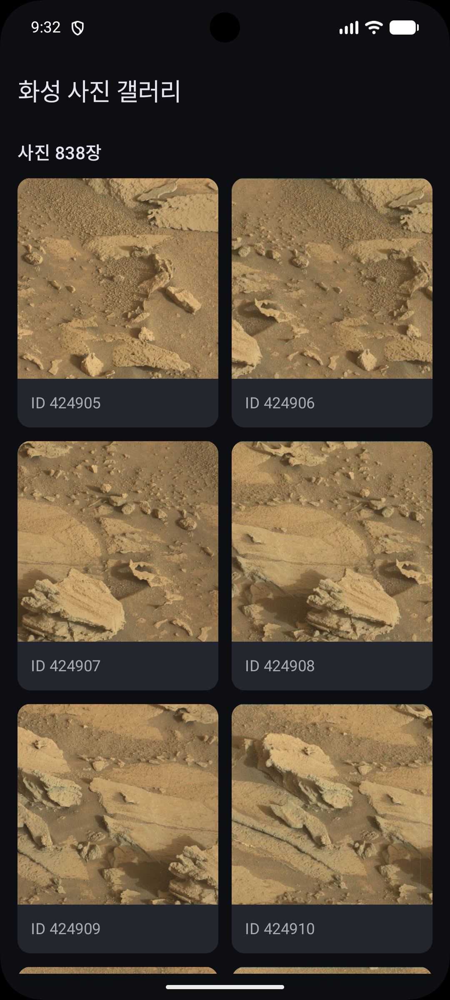
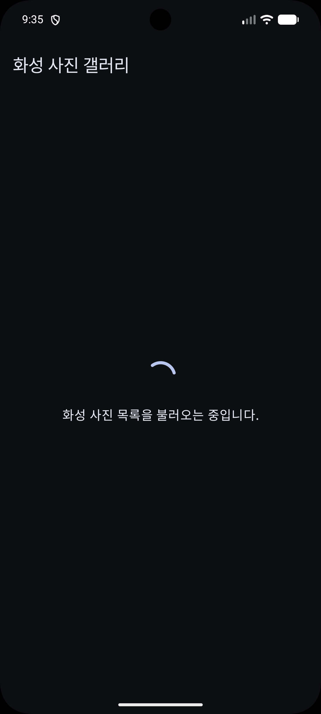
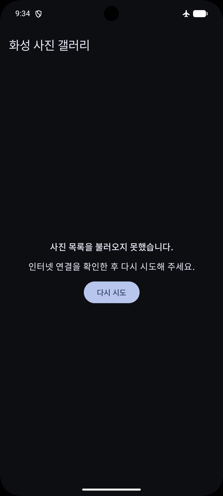
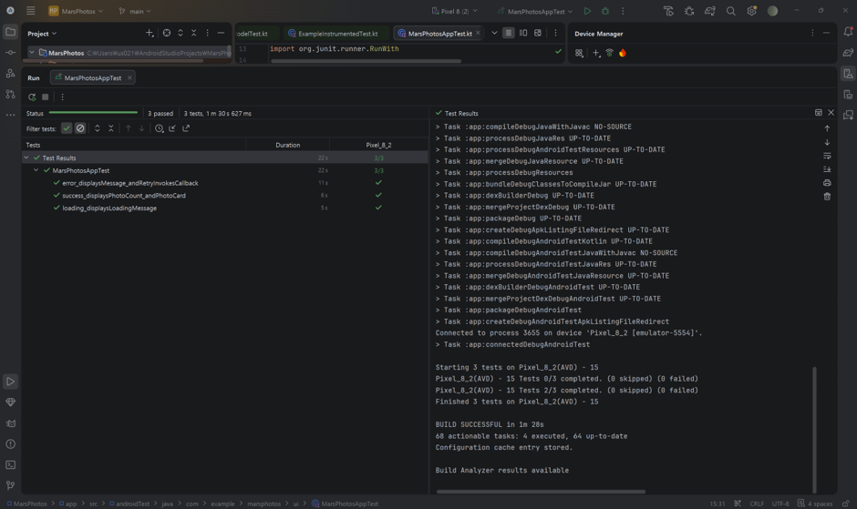

# MarsPhotos

화성 사진 목록을 공개 REST API에서 가져와 그리드로 보여주는 모바일 소프트웨어 10주차 과제다. Kotlin과 Jetpack Compose를 사용하며, 목록을 불러오는 중이거나 요청이 실패한 경우에는 별도의 화면을 표시한다.

## 기능

- Retrofit과 kotlinx.serialization으로 `GET /photos`의 JSON 응답을 `List<MarsPhoto>`로 변환한다.
- Coil 3의 `AsyncImage`로 원격 사진을 표시한다. 화면 폭에 맞춰 열 개수가 바뀌는 그리드에서 사진 개수와 각 사진의 ID를 볼 수 있다.
- ViewModel에서 Loading, Success, Error 상태를 관리한다. 목록 요청에 실패하면 `다시 시도` 버튼으로 요청을 다시 보낼 수 있다.

## 실행 및 테스트

Android Studio에서 프로젝트를 열고 Gradle Sync를 마친 뒤, 인터넷이 연결된 에뮬레이터에서 `app`을 실행한다.

```powershell
.\gradlew.bat :app:testDebugUnitTest --tests "com.example.marsphotos.ui.MarsViewModelTest"
.\gradlew.bat :app:connectedDebugAndroidTest
```

| 테스트 종류 | 테스트 파일 | 확인 항목 | 결과 |
| --- | --- | --- | --- |
| JVM 단위 테스트 | `app/src/test/java/com/example/marsphotos/ui/MarsViewModelTest.kt` | 응답 전 Loading과 응답 후 Success, 오프라인 요청 실패 시 Error, 실패 후 재시도 성공 (3건) | 3 PASSED |
| Compose UI 테스트 | `app/src/androidTest/java/com/example/marsphotos/ui/MarsPhotosAppTest.kt` | 로딩 문구, 오류 문구와 재시도 버튼 동작, 성공 화면의 사진 개수와 사진 ID (4건) | 4 PASSED |

Compose UI 테스트는 연결된 에뮬레이터에서 `:app:connectedDebugAndroidTest`를 실행하여 직접 검증을 완료했다.

## AI 활용 기록

10주차 강의 PDF를 ChatGPT에 첨부하고 전체 구현에 필요한 코드와 적용 방법을 한 번에 요청했다. 실제 입력한 요청은 다음과 같다.

> 위와 같은 방식으로 다음 pdf 파일에서 마지막 페이지에서 거론되는 과제를 해결할거야. 그에 필요한 상세한 안내를 구성해줘.

추가로 프로젝트 빌드 과정에서 Kotlin 컴파일러 `2.2.10`과 `Coil 3.5.0` 의존성 간의 `kotlin-stdlib:2.4.0` 메타데이터 호환성 오류가 발견되었다. AI 조언을 통해 `app/build.gradle.kts` 내 `coil-compose`와 `coil-network-okhttp` 버전을 호환 버전인 `3.3.0`으로 조정하여 메타데이터 불일치 및 연쇄 컴파일 에러를 해결하였다.

이 요청으로 프로젝트 구조, 의존성 설정, 앱 코드, 테스트 코드와 실행 절차를 받았다. 아래의 **기능별 프롬프트 예시**는 그 구현을 검토하면서 기술 스택, 요구사항, 작업 순서, 코드 형식을 드러내도록 재구성한 것이다.

### 1. 프로젝트와 의존성 설정

**원리** — JSON 직렬화 플러그인을 프로젝트의 Kotlin 버전에 맞추고, 네트워크와 이미지 로딩 의존성을 앱 모듈에 연결한다.

> Kotlin과 Jetpack Compose의 Empty Activity 프로젝트를 기준으로 Gradle Kotlin DSL 설정을 알려줘. 기존 Compose BOM과 템플릿 구조를 유지하고, Kotlin 버전 카탈로그를 참조하는 serialization 플러그인과 Retrofit, kotlinx.serialization, Coil 3, 코루틴 테스트 의존성을 추가할 위치를 파일별로 보여줘. Coil의 Compose 모듈과 OkHttp 네트워크 모듈은 같은 버전을 사용하고, Manifest에서 인터넷 권한을 넣을 위치도 알려줘.

**코드와 확인 항목** — `gradle/libs.versions.toml`의 serialization 별칭과 `app/build.gradle.kts`의 플러그인 적용을 확인한다. `AndroidManifest.xml`의 `INTERNET` 권한은 `<application>` 밖에 둔다.

### 2. 사진 데이터 모델

**원리** — API의 JSON 키를 Kotlin 프로퍼티에 매핑해야 응답을 사진 객체로 읽을 수 있다.

> Kotlin의 kotlinx.serialization으로 화성 사진 한 장을 표현하는 `MarsPhoto` 데이터 클래스를 만들어줘. 사진 ID와 이미지 URL을 문자열로 저장하고, 서버의 `img_src`는 `@SerialName`을 써서 Kotlin의 `imgSrc`에 연결해줘. `data/MarsPhoto.kt`에 붙여넣을 수 있는 코드로 작성해줘.

**코드와 확인 항목** — `@Serializable`이 붙은 `MarsPhoto`에 `id: String`과 `@SerialName("img_src") val imgSrc: String`이 있다.

### 3. Retrofit으로 사진 목록 요청

**원리** — Retrofit의 서비스 인터페이스에 요청 경로와 응답 타입을 선언하고, 변환기가 JSON을 사진 목록으로 읽는다.

> Retrofit 2.11과 kotlinx.serialization으로 강의의 화성 사진 API에 연결해줘. 기본 URL은 `https://android-kotlin-fun-mars-server.appspot.com/`으로 설정하고, `@GET("photos")`가 붙은 `suspend fun getPhotos(): List<MarsPhoto>`를 선언해줘. JSON에 모델에 없는 키가 들어와도 처리할 수 있도록 설정하고, 서비스 생성 코드를 `network/MarsApiService.kt`에 작성해줘.

**코드와 확인 항목** — `MarsApiService.getPhotos()`가 `List<MarsPhoto>`를 반환하고, `MarsApi`가 `Json { ignoreUnknownKeys = true }`를 사용한다.

### 4. 저장소 분리와 ViewModel 연결

**원리** — ViewModel이 저장소 인터페이스를 받으면 앱 실행에는 실제 네트워크 구현을, 테스트에는 가짜 구현을 사용할 수 있다.

> Kotlin에서 `MarsPhotosRepository` 인터페이스와 `NetworkMarsPhotosRepository` 구현을 나눠줘. 실제 구현은 Retrofit 서비스의 `getPhotos()`를 `withContext(Dispatchers.IO)` 안에서 호출하고, `MainActivity`의 ViewModel 팩토리에서 이 구현을 주입해줘. 테스트에서는 같은 인터페이스로 가짜 응답을 넘길 수 있게 해줘.

**코드와 확인 항목** — `data/MarsPhotosRepository.kt`에 인터페이스와 네트워크 구현이 있고, `MainActivity.kt`에서 생성한 저장소를 `MarsViewModel`에 넘긴다.

### 5. 요청 상태와 재시도

**원리** — 화면이 관찰하는 상태를 ViewModel에서 바꾸면 요청 결과에 맞춰 Compose 화면을 갱신할 수 있다.

> Kotlin과 AndroidX ViewModel로 `Loading`, `Success(photos)`, `Error`를 갖는 `MarsUiState`를 만들어줘. ViewModel 생성 시 `viewModelScope`에서 목록을 요청하고, 외부에서는 읽기 전용 `StateFlow`로 상태를 확인하게 해줘. 네트워크, HTTP, JSON 변환 오류는 Error로 전환하고, `loadPhotos()`를 다시 호출하면 재시도하되 이미 진행 중인 요청은 중복 실행하지 않도록 해줘.

**코드와 확인 항목** — `ui/MarsViewModel.kt`의 `uiState`와 `loadJob`을 확인한다. 재시도 시 Loading으로 바뀌고, 응답에 따라 Success 또는 Error로 전환된다.

### 6. 화면 구성과 배경

**원리** — 같은 앱 화면 안에서 상태에 따라 콘텐츠를 바꾸고, 색과 문자열은 테마와 리소스에서 가져온다.

> Jetpack Compose Material 3에서 Empty Activity가 생성한 `MarsPhotosTheme`를 사용해줘. `Scaffold`와 `TopAppBar`로 상단에 ‘화성 사진 갤러리’를 표시하고, `when`으로 로딩·오류·성공 화면을 나눠줘. 로딩에는 가운데 진행 표시기와 안내 문구를 넣고, 오류에는 안내 문구와 `onRetry`를 호출하는 ‘다시 시도’ 버튼을 넣어줘. 화면 문구는 `mars_strings.xml`에 분리하고 배경과 색은 테마의 색상 체계를 따르게 해줘.

**코드와 확인 항목** — `ui/MarsPhotosApp.kt`에서 `LoadingScreen`, `ErrorScreen`, `PhotosGrid`로 분기한다. `MainActivity`가 `collectAsStateWithLifecycle()`로 화면 상태를 전달한다.

### 7. 사진 카드와 그리드

**원리** — 그리드는 화면 폭에 맞춰 열을 배치하고, 각 카드가 개별 이미지의 로딩과 실패를 처리한다.

> Jetpack Compose의 `LazyVerticalGrid`에 `GridCells.Adaptive(150.dp)`를 사용해 사진 목록을 스크롤할 수 있게 해줘. 각 항목은 사진 ID를 키로 쓰고, 정사각형 이미지와 ID 문구를 `Card`에 넣어줘. Coil 3의 `AsyncImage`로 `imgSrc`를 읽고, 로딩 중에는 테마의 `surfaceVariant` 색을 표시하고, 사진 요청에 실패하면 오류 아이콘을 보여줘. 목록 위에는 받은 사진 개수를 표시해줘.

**코드와 확인 항목** — `PhotosGrid`가 사진 수를 표시하고, `AsyncImage`에 `contentDescription`, `placeholder`, `error`를 지정한다. 이미지 오류에는 `ic_mars_photo_error.xml`을 사용한다.

### 8. ViewModel 단위 테스트

**원리** — 가짜 저장소와 테스트 디스패처를 사용하면 네트워크 상태에 관계없이 코루틴 실행과 응답 시점을 제어할 수 있다.

> JUnit 4와 `kotlinx-coroutines-test`를 써서 `MarsViewModel`의 단위 테스트를 작성해줘. `TestDispatcherRule`로 Main 디스패처를 교체하고 `runTest`로 실행해줘. 첫 번째는 응답 대기 중 Loading에서 응답 후 Success로 전환되는지, 두 번째는 저장소가 `IOException`을 던지면 Error가 되는지, 세 번째는 첫 요청 실패 후 재시도가 성공하는지 검증해줘. 실제 API 호출 없이 `app/src/test`에서 실행할 수 있도록 구성해줘.

**코드와 확인 항목** — `TestDispatcherRule.kt`가 테스트 전후로 Main 디스패처를 설정하고 복원한다. `MarsViewModelTest.kt`에서 성공, 실패, 재시도 경로를 각각 검증한다.

### 9. Compose UI 테스트

**원리** — 화면에 상태를 직접 전달하면 UI가 표시하는 문구와 버튼 동작을 상태별로 확인할 수 있다.

> Jetpack Compose UI 테스트를 `app/src/androidTest`에 작성해줘. `MarsPhotosApp`에 Loading, Error, Success를 하나씩 전달하고, 로딩 문구, 오류 문구와 재시도 콜백 호출, 성공 화면의 사진 개수와 ID를 확인해줘. 이미지 다운로드에 의존하지 않도록 테스트 데이터를 만들어줘.

**코드와 확인 항목** — `MarsPhotosAppTest.kt`에서 상태별 화면과 `다시 시도` 버튼을 검증한다. 실제 사진 다운로드는 앱 실행 화면에서 확인한다.

### 10. 빌드 오류 해결

Android Studio Agent에 Kotlin 컴파일 오류 로그를 전달하고,
`kotlin-stdlib:2.4.0`이 어떤 라이브러리에서 들어왔는지 확인해 달라고 요청했다.

프로젝트의 Kotlin 컴파일러는 2.2.10이었고, Coil 3.5.0이
Kotlin 표준 라이브러리 2.4.0을 가져오면서 메타데이터 버전 충돌이 발생했다.
`app/build.gradle.kts`에서 `coil-compose`와 `coil-network-okhttp`를
모두 3.3.0으로 맞춘 뒤 디버그 빌드와 JVM 단위 테스트 4개가 통과했다.

## 실행 화면

### 사진 목록 표시



### Loading



### Error



### 단위 테스트 결과

 에뮬레이터(Android 15, API 35)에서 `MarsPhotosAppTest`의 테스트 3개가 모두 통과했다.

- 로딩 화면에 사진 목록을 불러오는 중이라는 안내가 표시되는지 확인했다.
- 오류 화면에 안내 문구가 표시되고, `다시 시도` 버튼을 누르면 재시도 콜백이 호출되는지 확인했다.
- 성공 화면에 사진 개수와 사진 카드의 ID가 표시되는지 확인했다.

